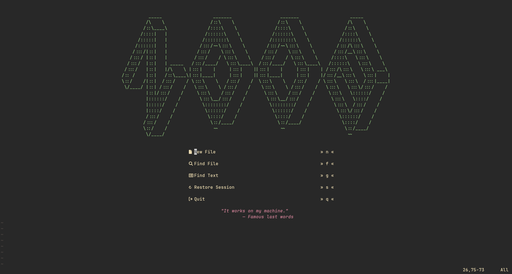
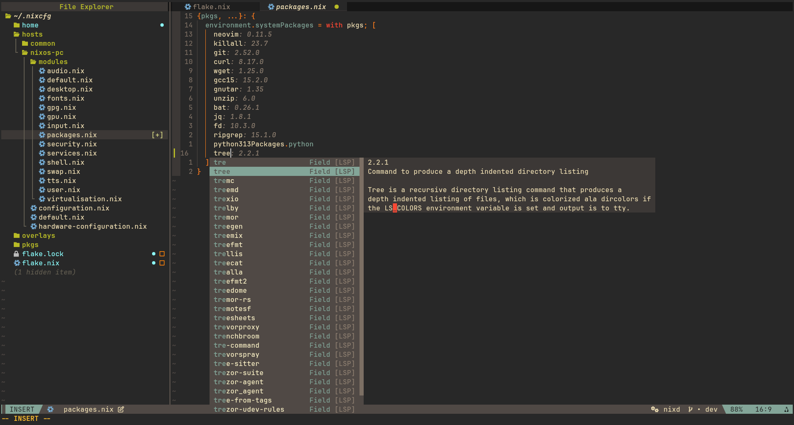
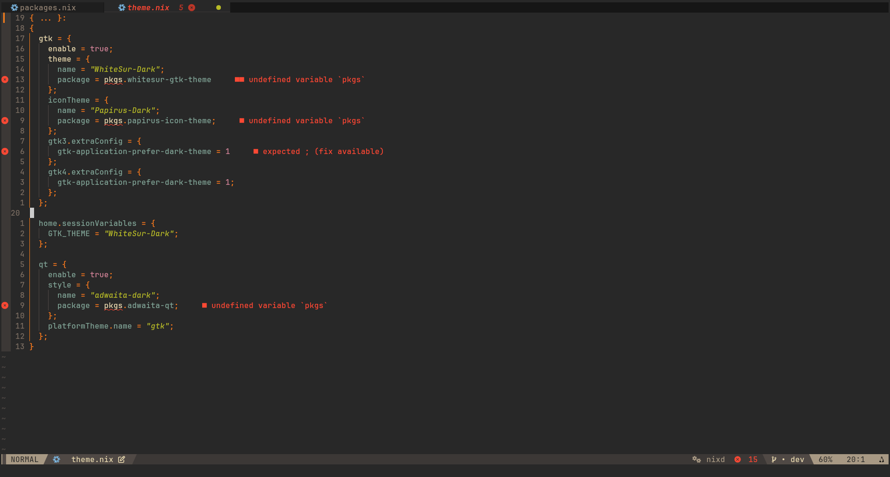

# Noobvim

This is my Neovim config using [nvf](https://github.com/NotAShelf/nvf).




# Supported languages

- Nix
- Bash
- Rust
- C/C++

More languages (Lua, Java, Dart, Go, TypeScript, CSS, HTML, TOML) are available
and can be enabled by uncommenting them in `modules/languages/default.nix`.

# Structure

- `flake.nix`: builds the Neovim package with [nvf](https://github.com/NotAShelf/nvf)
- `modules/`: nvf modules, all imported from `modules/default.nix`
  - `config.nix`, `options.nix`, `theme.nix`, `keymaps.nix`: general settings and keymaps
  - `plugins/`: one file per plugin, holding its config and its keymaps
  - `languages/`: one file per language (LSP, treesitter, formatter and its packages)
- `runtime/`: plain Lua added to the runtime path
  - `ftdetect/`, `ftplugin/`, `syntax/`: per-filetype detection and settings
  - `plugin/`: autocommands and user commands loaded on startup

## Basic keybinds

`leader` key is space key.
| Key | Action |
|--|--|
| \<leader>e | Toggle neo-tree
| \<leader>ff | Find files
| \<leader>fg | Find text
| \<leader>fb | Find buffers
| \<leader>cf | Format file (if supported)
| \<leader>bd | Delete current buffer
| \<Ctrl>h/j/k/l | Move focus to other splited window
| \<leader>j/k | Move line down/up
| J/K (visual) | Move selection down/up
| \<Shift>h/l | Move focus to other tab
| \<Ctrl>/ | Toggle terminal

## How to install

If you would like to try out the default configuration before even _thinking about_ installing it, you may run the following in order to take **noobvim** out for a spin.
```
nix run github:justanoobcoder/noobvim
# If you want to open a file, run this instead
nix run github:justanoobcoder/noobvim -- ~/mynixconfig/flake.nix
```
If you want to install **noobvim** in your system, add **noobvim** url to your flake inputs:
```
inputs = {
  nixpkgs.url = "github:NixOS/nixpkgs/nixos-unstable";
  
  noobvim = {
    url = "github:justanoobcoder/noobvim";
    inputs.nixpkgs.follows = "nixpkgs";
  };
};
```
Then add the package to your package list:
```
# If you use home-manager
home.packages = with pkgs; [
  inputs.noobvim.packages.${pkgs.stdenv.hostPlatform.system}.default
];

# If you don't use home-manager
environment.systemPackages = with pkgs; [
  inputs.noobvim.packages.${pkgs.stdenv.hostPlatform.system}.default
];
```
